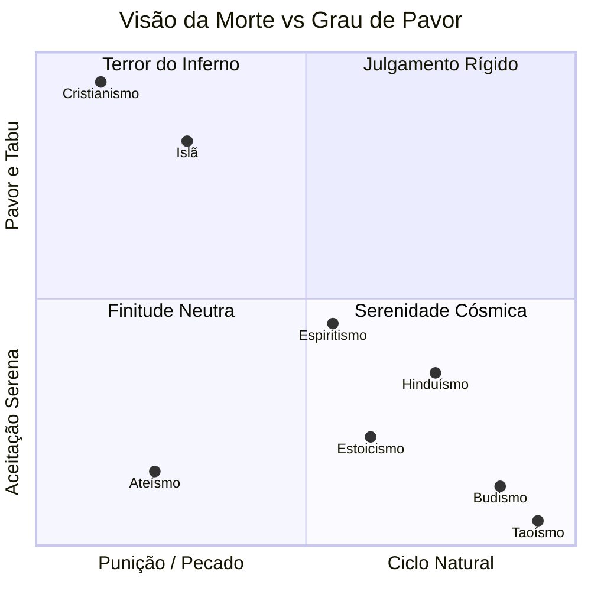
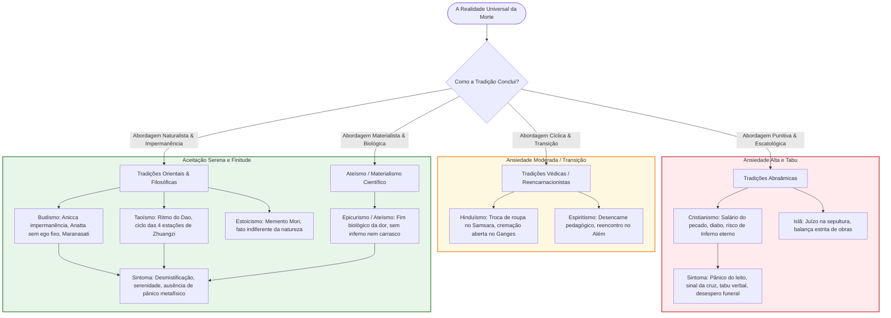

# Como as Diferentes Religiões e Tradições Filosóficas Lidam com a Morte: Mapeamento, Gráfico Mermaid e o Paradoxo da Tanatofobia Cristã

> **Nota:** Esta é a versão enriquecida com diagramas interativos em **Mermaid**, mantendo o documento original intacto em [`as-religioes-e-a-morte-grafico-e-o-paradoxo-cristao.md`](as-religioes-e-a-morte-grafico-e-o-paradoxo-cristao.md).

---

## 1. Introdução: A Morte como Matriz de Toda Religião

O antropólogo Ernest Becker (*A Negação da Morte*, 1973) e o filósofo Arthur Schopenhauer apontaram que **a morte é a musa de todas as filosofias e a mãe de todas as religiões**. Se o ser humano fosse imortal biologicamente, é provável que nenhuma religião jamais tivesse existido.

Contudo, a forma como cada cultura e sistema de crenças processa o fim biológico varia radicalmente. Enquanto algumas tradições integraram a finitude como parte orgânica, harmoniosa e necessária do ciclo cósmico — acalmando o cérebro humano diante do inevitável —, outras transformaram a morte em uma arma de intimidação e controle social, associando-a à punição, à culpa e ao risco de tortura eterna.

Dentre essas, nenhuma é mais paradoxal e contraditória do que a tradição cristã: uma religião que promete publicamente a vida eterna ao lado do Criador, mas cujos devotos manifestam o pânico mais agudo e visceral diante da própria ideia de morrer.

---

## 2. Espectro Comparativo: Como Cada Tradição Enxerga a Morte

Podemos classificar as tradições religiosas e filosóficas em três grandes atitudes conceituais:

1. **A Morte como Punição, Inimiga e Tabu Aterrorizante** (Foco no julgamento, pecado e ameaça);
2. **A Morte como Estágio Natural, Cíclico ou Impermanência** (Foco na ordem do cosmos, diluição da culpa e normalidade);
3. **A Morte como Fim Neutro / Dissolução Serena do Ego** (Foco na realidade material, libertação do sofrimento ou retorno ao nada).

---

### A. Tradições Abraâmicas (Cristianismo e Islã) — *A Morte como Inimiga e Julgamento*

- **Concepção Dogmática**:
  - No Cristianismo bíblico, a morte física e espiritual não é parte natural do plano cósmico original: ela é uma aberração introduzida no mundo pelo "pecado original" de Adão e Eva (*"O salário do pecado é a morte"*, Romanos 6:23). Na teologia paulina, a morte é explicitamente qualificada como **"o último inimigo a ser vencido"** (1 Coríntios 15:26).
  - No Islã, a morte (*Mawt*) é um decreto absoluto de Alá, seguido imediatamente pelo interrogatório na sepultura pelos anjos Munkar e Nakir e pelo terror do Dia do Juízo (*Yawm al-Qiyamah*).
- **Impacto Psicológico no Fiel**:
  - **Altíssima Ansiedade e Pânico**: Ao vincular a morte ao julgamento final com risco de condenação a um inferno de sofrimento sádico e eterno, essas religiões transformam o leito de morte em uma roleta russa escatológica. O fiel nunca tem certeza absoluta de que é digno ou salvo, gerando uma neurose de culpa contínua.
  - **A Morte como Tabu Verbal**: No cristianismo popular, a morte é associada ao demônio, à desgraça e à impureza. A mera menção à palavra morte engatilha sinais da cruz, toques na madeira e exclamações automáticas de afastamento (*"Deus me livre!"*, *"Em nome de Jesus, repreendo!"*).

---

### B. Tradições Orientais e Védicas (Budismo, Hinduísmo, Jainismo) — *A Morte como Estágio Natural e Ciclo*

- **Budismo**:
  - **Concepção**: No Budismo, a morte não é um castigo divino nem um drama cósmico; é a manifestação direta de ***Anicca*** (a lei universal da impermanência). Tudo o que nasce precisa decair e cessar.
  - **Ausência de Alma Fixa (Anatta)**: Como o budismo não acredita em um "Ego permanente" (*Anatta*), não há uma identidade sólida a ser destruída na morte. A morte é apenas a dissolução dos cinco agregados (*skandhas*). O sofrimento humano não vem da morte, mas do apego (*Upadana*) à ilusão de permanência.
  - **Prática do Maranasati**: Monges budistas meditam frequentemente em cemitérios abertos sobre corpos em decomposição (*Maranasati*), não por morbidez, mas para treinar a mente a ver a morte com absoluta naturalidade, dessensibilizando o medo.
- **Hinduísmo**:
  - **Concepção**: O corpo físico (*Deha*) é comparado a uma peça de roupa passageira. No célebre verso do *Bhagavad Gita* (2:22): *"Assim como alguém descarta roupas velhas e desgastadas e veste roupas novas, a alma descarta corpos desgastados e entra em novos corpos"*.
  - A morte é uma transição inevitável da roda do *Samsara*. Para o hindu tradicional, morrer às margens do Rio Ganges (em Varanasi) é celebrado como uma transição sagrada e solene, com cremações a céu aberto onde as famílias convivem pacificamente com os restos mortais.

---

### C. Filosofias Naturalistas e Animistas (Taoísmo, Estoicismo e Xintoísmo) — *A Morte como Ritmo da Natureza*

- **Taoísmo**:
  - Para Lao Tsé e Zhuangzi, a vida e a morte são como o dia e a noite, o inspirar e o expirar. O ser humano é apenas uma condensação temporária da energia primordial (*Qi*) do *Dao*.
  - Quando a esposa de Zhuangzi morreu, um amigo foi visitá-lo e o encontrou cantando e batendo alegremente em uma bacia de cerâmica. Chocado, o amigo perguntou se ele não tinha respeito. Zhuangzi respondeu: *"No começo ela não tinha vida, não tinha forma e não tinha Qi. Agora, uma nova transformação ocorreu e ela faleceu. É como o ciclo das quatro estações: primavera, verão, outono e inverno. Se eu chorasse e me desesperasse, estaria demonstrando que não compreendi o destino natural das coisas"*.
- **Estoicismo (Grécia e Roma Antiga)**:
  - Epicteto, Sêneca e Marco Aurélio ensinaram que a morte não é um mal em si, mas um fato natural indiferente (*adiaphoron*).
  - O famoso exercício do ***Memento Mori*** ("lembre-se de que você vai morrer") e o ***Amor Fati*** (amar a realidade e o destino) tinham a função terapêutica de libertar o cidadão do medo da morte, ensinando-o a valorizar cada segundo do presente sem carregar ilusões transcendentais.

---

### D. Ateísmo / Materialismo Científico — *A Morte como Cessação Serena e Ausência de Dano*

- **Concepção**: A consciência é um processo biológico emergente do funcionamento do cérebro. Cessada a atividade eletroquímica neuronal, a experiência subjetiva cessa definitivamente.
- **A Tese de Epicuro e Mark Twain**:
  - Epicuro (filósofo materialista do século IV a.C.) formulou o argumento da simetria: *"A morte não é nada para nós. Pois tudo o que é bom ou mau reside nas sensações, e a morte é a privação da sensação. Portanto, enquanto nós existimos, a morte não está aqui; e quando a morte está aqui, nós já não existimos mais."*
  - O escritor Mark Twain resumiu a mesma verdade de forma irônica e reconfortante: *"Eu não temo a morte. Eu estive morto por bilhões e bilhões de anos antes de nascer, e não sofri o menor inconveniente com isso."*
- **Impacto Psicológico**: Não há julgamento, não há inferno, não há vingança cósmica e não há tormento pós-morte. A morte é o repouso absoluto que precede e sucede a breve faísca consciente da vida biológica.

---

## 3. Gráficos em Mermaid: Mapeamento Conceitual e Espectro Tanatológico

Abaixo apresentamos duas visualizações em Mermaid:
1. Um **gráfico de quadrantes (Quadrant Chart)** mapeando Concepção da Morte versus Nível de Pavor e Ansiedade Induzida;
2. Um **diagrama de fluxo estrutural (Mindmap / Flowchart)** detalhando o impacto de cada via doutrinária sobre a psicologia do devoto.

### Gráfico de Quadrantes 2D (quadrantChart): Concepção da Morte vs. Pavor Escatológico

---

### Diagrama de Fluxo e Categorização das Tradições

---

### Tabela Resumo Comparativa

| Tradição / Sistema | Concepção Central da Morte | O que Ocorre Pós-Morte | Nível de Pavor Induzido | Tratamento Social da Morte |
|:---|:---|:---|:---:|:---|
| **Cristianismo Popular / Dogmático** | Fruto do pecado original, obra do demônio, inimigo supremo. | Céu para poucos eleitos; Inferno de fogo eterno para a maioria. | **Extremo (Pânico / Tabu)** | Tabu verbal absoluto, medo de falar no assunto, sinal da cruz de repulsa, desespero funeral. |
| **Islã** | Decreto inevitável de Alá; encerramento da prova terrena. | Julgamento da sepultura, ressurreição corporal, Paraíso (*Jannah*) ou Fogo (*Jahannam*). | **Alto** | Rituais rápidos de enterro com mortalha simples; forte vigilância sobre pecados. |
| **Espiritismo** | Desencarne; passagem de dimensão vibratória. | Retorno à pátria espiritual; novas reencarnações pedagógicas. | **Baixo a Moderado** | Normalizado como "viagem"; consolo de reencontro e comunicação com médiuns. |
| **Hinduísmo** | Descarte de corpo velho; continuação da roda cármica (*Samsara*). | Reencarnação segundo as ações (*Karma*) até a libertação final (*Moksha*). | **Moderado / Baixo** | Naturalizado publicamente; cremações rituais no Ganges; aceitação do ciclo. |
| **Budismo** | Manifestação inevitável da impermanência (*Anicca*); dissolução dos agregados. | Não há alma fixa (*Anatta*); fluxo causal de consciência até o *Nirvana*. | **Muito Baixo** | Parte central da prática espiritual; meditação sobre a morte para cortar apegos. |
| **Taoísmo** | Retorno da forma transitória ao fluxo eterno do *Dao*. | O vapor/energia dissolve-se nas forças universais do Yin e Yang. | **Nulo / Mínimo** | Aceitação serena do ritmo cósmico, comparado à passagem do outono para o inverno. |
| **Ateísmo / Epicurismo** | Cessação biológica definitiva da consciência. | Nada. O mesmo estado de não existência anterior ao nascimento. | **Baixo / Racional** | Aceitação da finitude; valorização da vida presente; rejeição de medos sobrenaturais. |

---

## 4. O Paradoxo da Tanatofobia Cristã: Por Que os Devotos do Céu Têm Tanto Pavor de Morrer?

Chegamos ao cerne da contradição apontada pelo autor:

> *"Nunca entendi porque uma religião onde quando se morre se ganha o direito de estar ao lado do seu criador gera devotos tão apavorados com a ideia da morte que a própria citação da morte já engatilha sinais da cruz e palavras de afastamento em nome de Deus... Muito ambíguo."*

Essa ambiguidade grotesca revela quatro engrenagens psicológicas e doutrinárias que desmascaram a hipocrisia da fé dogmática:

### 1. A Cláusula Oculta do Contrato: A Sombra do Inferno
A propaganda cristã diz que a morte é a promoção para o Paraíso. Porém, a **teologia real** diz algo muito diferente:
- A Bíblia ensina explicitamente que o caminho da salvação é apertado e que **a imensa maioria da humanidade será lançada no tormento eterno** (*"Muitos são chamados, mas poucos escolhidos"*, Mateus 22:14; *"Larga é a porta que conduz à perdição e muitos entram por ela"*, Mateus 7:13).
- O crente nunca tem 100% de garantia psicológica de que atingiu a perfeição exigida por um Deus que pune até pensamentos libidinosos ou dúvidas passageiras. A morte, para o cristão, não é um abraço acolhedor de um pai amoroso: **é o comparecimento obrigatório a um tribunal penal cósmico onde a pena mínima para quem falhar é ser torturado para todo o sempre**. O sinal da cruz que ele faz ao ouvir a palavra morte é o reflexo involuntário do réu apavorado com a sentença do juiz.

### 2. A Teologia que Demonizou a Natureza
Ao contrário do budista ou do taoísta, que veem a decomposição física como um processo biológico nobre e neutro da matéria, o cristianismo ensinou durante 2.000 anos que a morte é uma sujeira demoníaca decorrente do pecado de Eva.
- A carne foi rotulada como inimiga do espírito;
- A morte foi personificada como um cavaleiro do Apocalipse;
- O próprio rito funeral ocidental foi tingido de luto negro, desespero e cânticos de súplica fúnebre (*Dies Irae* — "Dia da Ira").

### 3. O Conflito Biológico: O Sistema Nervoso Sabe a Verdade
Existe um abismo entre o que o crente **gostaria que fosse verdade** e o que o seu **sistema nervoso biológico sabe que é fato**:
- O cérebro humano é o resultado de quase 4 bilhões de anos de uma linha ininterrupta de sobreviventes. Cada célula do nosso corpo grita pela preservação da vida.
- No nível inconsciente e fisiológico, o crente não sente nenhuma presença de mansões celestes. Ele sabe intuitivamente que entrar em um caixão é o fim absoluto de sua experiência sensorial. A crença no céu é apenas uma camada fina de verniz teológico aplicada sobre um abismo de terror primal. Quando o perigo real se aproxima, o verniz estala e o instinto animal de sobrevivência toma o controle.

### 4. A Hipocrisia Comportamental Revelada
A prova definitiva de que a teologia cristã da salvação pós-morte não se sustenta na prática cotidiana reside nas reações concretas dos próprios crentes:
- **A oração nos hospitais**: Se a morte é de fato o momento glorioso em que o filho de Deus finalmente vai para os braços do Pai viver em gozo perpétuo sem dor, por que toda a igreja chora, suplica e jejua em vigílias para que Deus **NÃO** o leve? Por que uma cura médica (que obriga o indivíduo a continuar trabalhando, sofrendo e pagando boletos na Terra) é celebrada com lágrimas de alegria como um "grande milagre", enquanto a morte (a suposta ida para o Paraíso eterno) é lamentada como uma tragédia devastadora?
- **O contraste**: Se a fé fosse sincera e sólida, o velório cristão seria uma festa de formatura regada a champanhe, e os fiéis competiriam com entusiasmo para ver quem vai antes para a glória. O desespero inconsolável nos funerais cristãos é a confissão involuntária e silenciosa de que a fábula do céu é incapaz de acalmar a realidade da perda.

---

## 5. Roteiro Prático para Questionamento em Diálogos

Para expor essa contradição em um debate com uma pessoa religiosa, conduza a reflexão com serenidade:

1. **A Pergunta sobre a Ambiguidade**:
   - *"Você acredita sinceramente que quando você morrer você vai para o Céu estar com Jesus, num lugar sem dor, onde terá felicidade eterna?"*
   - O interlocutor afirmará que sim com convicção doutrinária.
2. **O Teste da Coerência Emocional**:
   - *"Se você tem certeza absoluta de que ir para o Céu é a melhor coisa que poderia lhe acontecer em toda a eternidade, por que você faz sinal da cruz e bate na madeira com pavor sempre que alguém fala em morrer?"*
   - *"Por que quando um irmão da igreja está com uma doença grave, vocês oram desesperados pedindo para Deus deixá-lo aqui neste mundo sofrido, em vez de darem graças a Deus por ele estar prestes a ganhar a glória eterna?"*
3. **O Espelho de Outras Religiões**:
   - *"Você sabia que os budistas e taoístas encaram a morte sem nenhum pavor de inferno, meditando sobre o fim como algo tão natural quanto a queda de uma folha no outono? Não lhe parece irônico que a religião que mais promete o paraíso seja justamente aquela cujos membros mais tremem de medo da morte?"*
4. **A Conclusão Lúcida**:
   - *"O pavor da morte que você sente não é falta de oração; é o seu cérebro de primata lhe avisando que a vida real é esta aqui, agora. O medo do inferno foi inventado pela sua igreja para manter você obediente até o último suspiro; a verdadeira paz não vem de fantasiar uma mansão no céu, mas de ter a coragem de aceitar a beleza da nossa finitude."*
